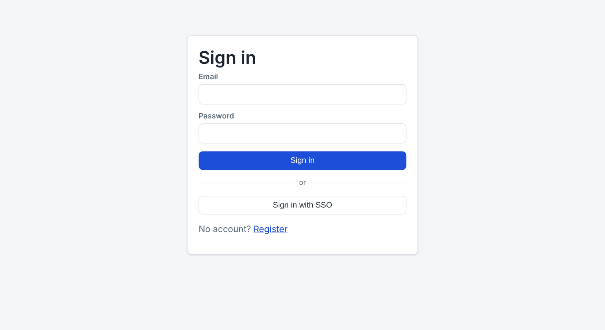
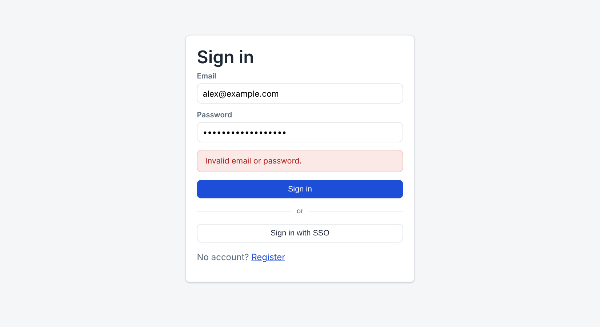
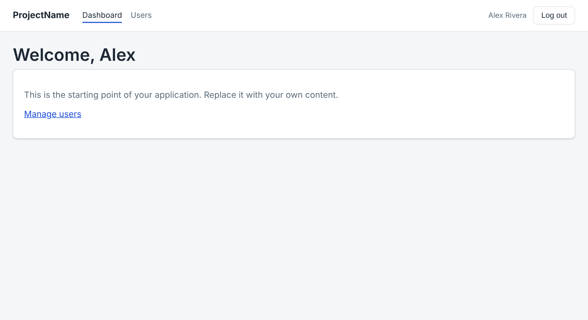
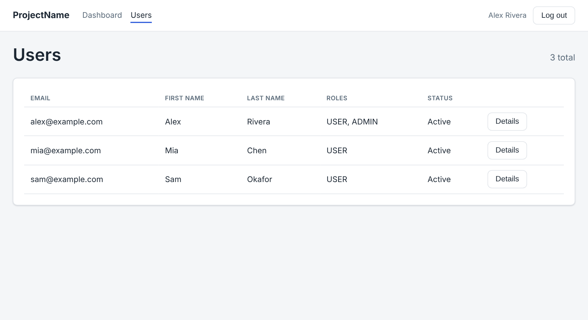

# project-name

A starter template for a Spring Boot API with an Angular frontend: JWT access
tokens, revocable refresh tokens, optional OIDC single sign-on (Keycloak for
local development), Flyway migrations, a shared UI component set, and CI with
secret scanning, CodeQL and dependency scanning.

Click **Use this template** on GitHub, clone, then run:

```bash
./rename.sh my-service            # or: ./rename.sh my-service com.mycompany
cd backend && mvn spotless:apply  # the new package changes import order
cp ../.env.example ../.env        # then set JWT_SECRET
docker compose up --build         # Postgres, Keycloak, backend, frontend
```

`rename.sh` swaps the placeholder tokens (`project-name`, `project_name`,
`projectname`, `ProjectName`, `com.example`), moves the Java package
directories and renames files, then deletes itself.

The frontend is served at <http://localhost:8081>, the API at
<http://localhost:8080> (Swagger UI at `/swagger-ui.html`), Keycloak at
<http://localhost:8180>.

## Screenshots









_Real captures from a local run (Spring Boot jar, Angular dev server, PostgreSQL), driven with Playwright. Keycloak was not running, so the SSO button is shown but not exercised, and one account was promoted to `ROLE_ADMIN` directly in the database to reach the Users page._

## What is included

### Backend (`backend/`, Spring Boot 4, Java 21)

| Area | Contents |
| --- | --- |
| Auth | `POST /api/v1/auth/{register,login,refresh,logout}`. Stateless HS256 access tokens (`JwtService`) with roles as a claim. |
| Refresh tokens | Opaque, stored only as a SHA-256 hash, single use (rotation), revoked on logout, rejected once the user is deactivated. |
| OIDC | Authorization-code login through Spring's `oauth2Login` on its own filter chain (`/oauth2/**`, `/login/**`). Links to an existing account by email or provisions a new one, then redirects to the SPA with a token pair in the URL fragment. |
| Roles | `ROLE_ADMIN` and `ROLE_USER` (`RoleName`). `@EnableMethodSecurity` is on; `GET /api/v1/users` and `PUT /api/v1/users/{id}/roles` need `ADMIN`. |
| Rate limiting | Bucket4j token buckets (per IP for the whole API, tighter per credential and per IP for login). Honours `X-Forwarded-For` only from configured trusted proxies. |
| Errors | `GlobalExceptionHandler` returns `ApiError` with `message`, `details` and `fieldErrors` (a map of request field to messages) for validation failures. |
| Paging helpers | `PageParams` (safe page, size and allow-listed sort), `PageResponse<T>` (stable JSON shape), and `BaseRepository<T>` with `getOrThrow` and `findPage`. `GET /api/v1/users?page=0&size=20&sort=email,asc` is the reference use. |
| Persistence | `BaseEntity` (id, created and updated timestamps). Flyway migrations for users, roles, refresh tokens and the OIDC identity columns only. |
| Config | `application.yml` plus `dev` and `prod` profiles; every deployment value is an environment variable. CORS, OpenAPI with a bearer scheme, Actuator health probes. |
| Tests | Unit tests run without Docker (`mvn test`). `*IT` tests use Testcontainers (PostgreSQL and a real Keycloak seeded from `keycloak/project-name-realm.json`) and run in `mvn verify`. |
| Formatting | Spotless with google-java-format, checked in `mvn verify`; `mvn spotless:apply` fixes it. |

### Frontend (`frontend/`, Angular 20, standalone components, signals)

| Area | Contents |
| --- | --- |
| Auth | `Auth` service (signals, localStorage-backed session, SSO start and completion), `authGuard`, `roleGuard`, `authInterceptor` (bearer header, sign-out on 401). Login, register and SSO-callback pages. |
| Shared UI | `app-button` (loading state), `app-form-field` (label, client validation messages and server field errors), `app-alert`, `app-spinner`, `app-empty-state`, `app-modal`, `app-pagination`, `app-data-table` (loading, empty, sortable headers, row actions). Each has a spec. |
| Reference page | `features/users/user-list` combines data table, pagination and modal against the backend's paged endpoint. |
| API helpers | `parseApiError` turns any failed HTTP call into a message plus per-field errors; `PageResponse` and `ApiError` models mirror the backend. |
| Tooling | ESLint with angular-eslint (including template accessibility rules), Karma and Jasmine with a `ChromeHeadlessCI` launcher, dev-server proxy, nginx config and Dockerfile for production. |

### Repository

Governance files (`LICENSE` (MIT), `SECURITY.md`, `CONTRIBUTING.md`,
`CODE_OF_CONDUCT.md`), issue and pull request templates, Dependabot,
workflows with SHA-pinned actions (`ci.yml`, `security.yml`, `codeql.yml`),
`osv-scanner.toml` (dated exceptions only), an empty `.gitleaksignore`, a `docs/project-memory/`
scaffold (`scaffold-memory-pack.sh` recreates missing files) and `CLAUDE.md`.

## Commands

```bash
# Backend
cd backend
mvn test                  # unit tests, no Docker needed
mvn verify                # + integration tests (Docker required) + format check
mvn spotless:apply        # fix formatting

# Frontend
cd frontend
npm ci
npm start                 # dev server on :4200, proxies /api, /oauth2, /login to :8080
npm run lint
CHROME_BIN=/path/to/chrome npx ng test --no-watch --browsers=ChromeHeadlessCI --karma-config=karma.conf.js
npx ng build --configuration production
```

Run the backend locally with a Postgres on `localhost:5432` (database, user
and password `project_name`, or override `DB_*`). The `dev` profile has a
development-only JWT secret; production requires `JWT_SECRET`.

## Before you ship

1. Edit the copyright line in `LICENSE` and the contact in `SECURITY.md`.
2. Replace the Keycloak realm and the `OIDC_*` settings with your identity
   provider, or delete the OIDC pieces (see below).
3. Set real secrets through your platform: `JWT_SECRET`, `DB_*`,
   `OIDC_CLIENT_SECRET`, `CORS_ALLOWED_ORIGINS`.
4. Add a seed or bootstrap step for your first `ADMIN` user; registration only
   creates `USER` accounts.
5. In GitHub, turn on the dependency graph (the dependency review job needs
   it), branch protection for `main`, and require the CI jobs.

## Removing the optional OIDC module

Delete `OidcAuthentication{Success,Failure}Handler`, `OidcProperties`, the
`oidcFilterChain` bean in `SecurityConfig`, the `spring.security.oauth2` block
in both `application.yml` files, `V3__oidc_identity.sql` (and the two OIDC
columns on `User`), `keycloak/`, the `keycloak` service in
`docker-compose.yml`, the `AbstractOidcIntegrationTest` family, and in the
frontend `SsoCallback`, `startSsoLogin`/`completeSsoLogin` and the SSO button.
